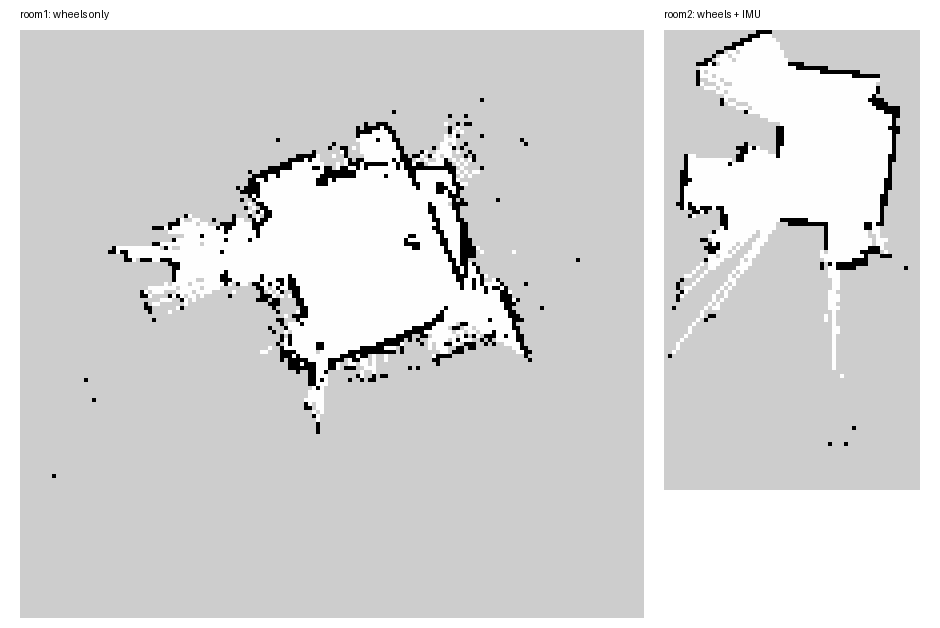
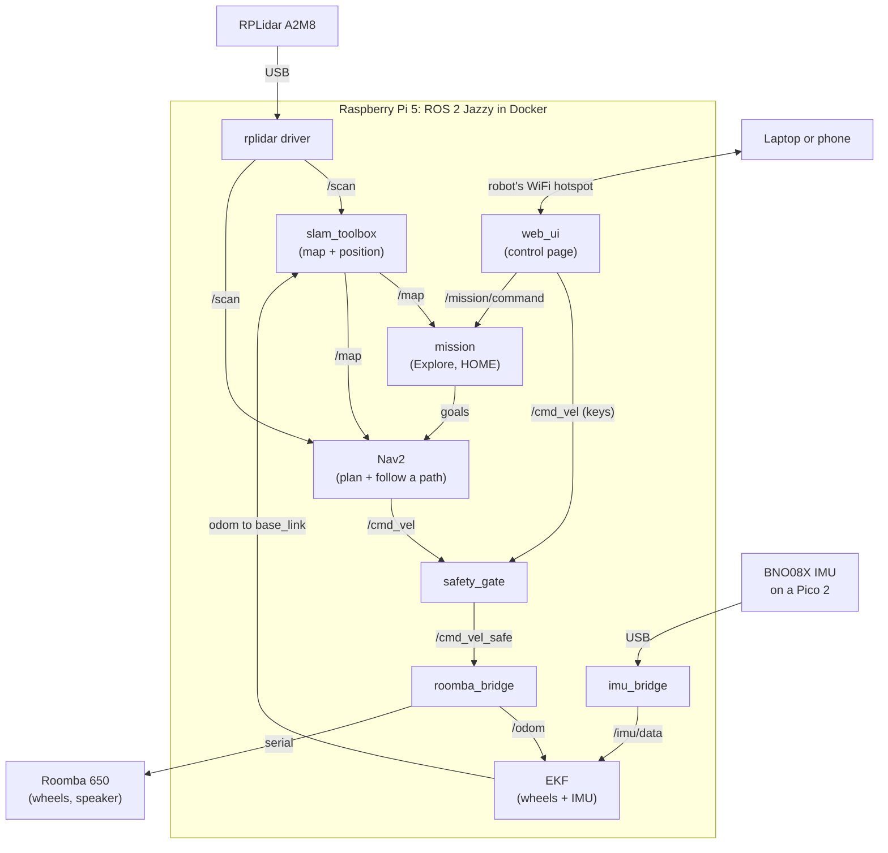
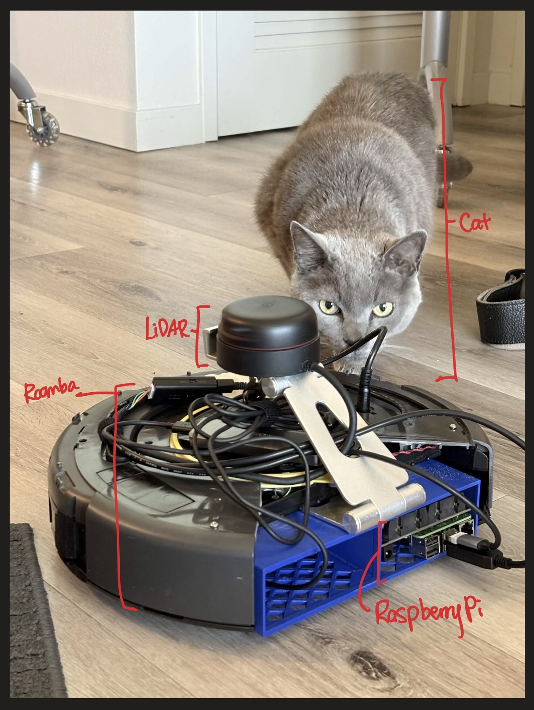
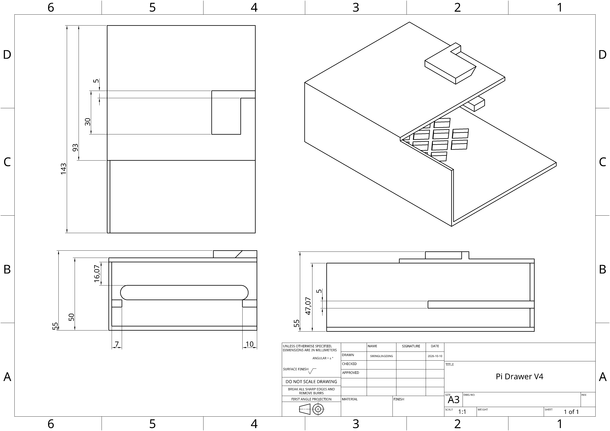
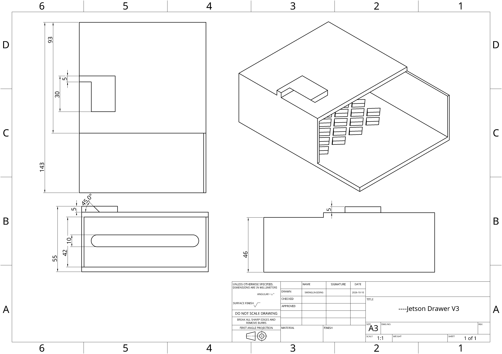
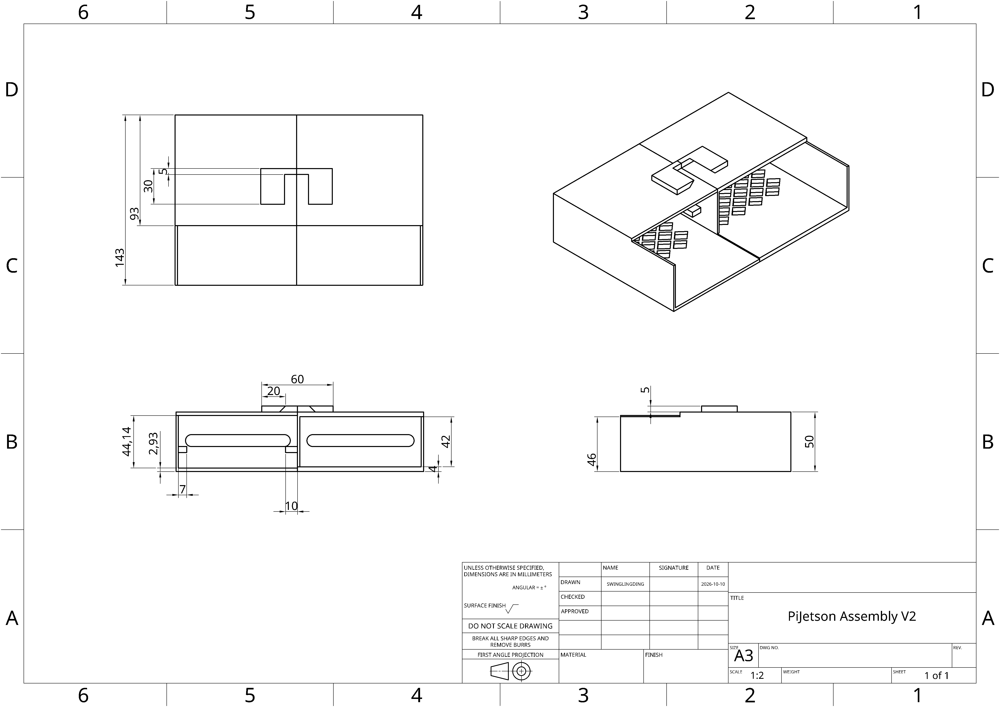
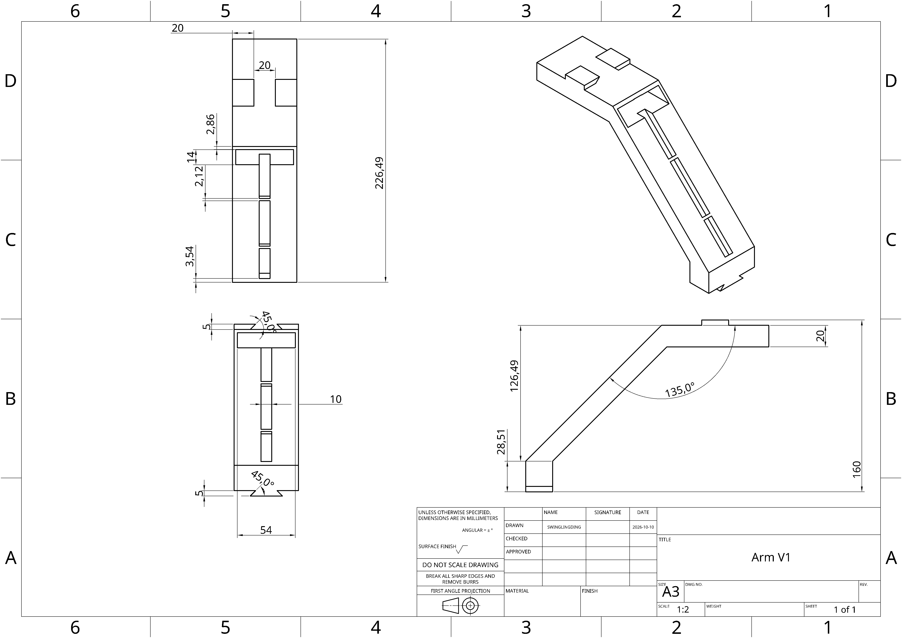
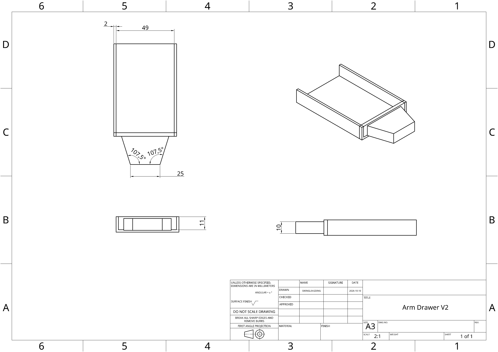
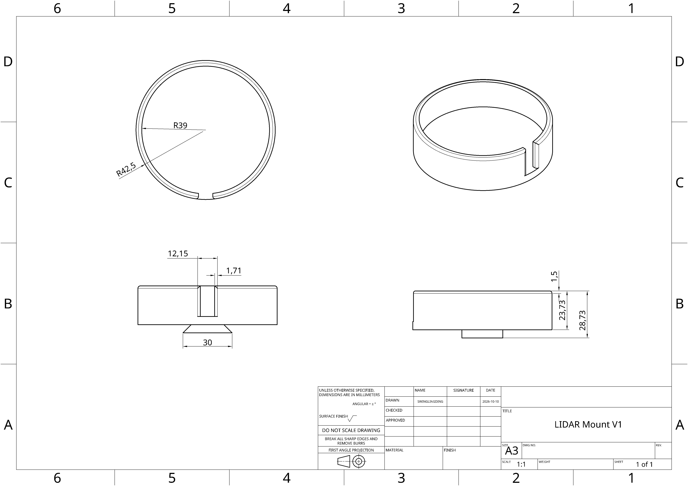

# Project L.U.C.I.A.

SJSU CMPE 195A/B senior design, team 37. **Advisor:** Professor Wencen Wu

## Team

| Name | GitHub | Email |
|------|--------|-------|
| Christian Michael Villanueva | [@Chris4lyfie](https://github.com/Chris4lyfie) | christianmichael.villanueva@sjsu.edu |
| Ling Tang | [@ling-tang0922](https://github.com/ling-tang0922) | ling.tang@sjsu.edu |
| Ethanael Grimares | [@Memekushi](https://github.com/Memekushi) | ethanael.grimares@sjsu.edu |
| Noel Temores | [@noel-tem](https://github.com/noel-tem) | noel.temores@sjsu.edu |


## Project Description

An indoor robot that maps a room on its own. Built on a Roomba 650: turn it on, and it
explores the room by itself, builds a map with its lidar, and drives back to where it
started. A Raspberry Pi 5 runs everything and serves a control page over the robot's
own WiFi.

## Prototype Scope (October 2026)

- **Explores on its own.** Frontier exploration: it drives to the edges of what it has
  mapped, one after another, until nothing reachable is left, then returns HOME. Works on
  the robot as of 2026-10-17.
- **Builds a 2D map** with the lidar (slam_toolbox), with heading from an IMU (BNO08X) fused
  in, which removed the drift of the first maps.
- **Web control page**, served by the robot over its own WiFi: start mapping, Explore / Return HOME / STOP,
  a live radar of the lidar, live metrics (heading, speed, distance, area mapped, Pi
  health), every node's log, Reconnect Roomba (after it was turned off and on, without
  losing the map), a horn and tunes on the Roomba's speaker (including melodies imported
  from MIDI files), drive by keyboard for testing, save and download maps.
- **Starts by itself:** power on and the Pi brings up its hotspot and the page; no screen,
  keyboard or other network needed.
- **In progress:** a time-of-flight safety stop for things below the lidar (Noel), object
  recognition with a ZED 2i camera on a Jetson Nano (Ethan). Not working yet: battery and
  wheel encoder readings (the Roomba's serial replies don't reach the Pi).



## System Architecture

Everything on the robot runs on the Raspberry Pi 5, as ROS 2 nodes in one Docker
container. The lidar and the IMU reach the Pi over USB, the Roomba over its serial port,
and people reach the robot through a web page on the Pi's own WiFi.



How a run works:

1. **Sense.** The lidar scans about 12 times a second, the IMU reports heading 50 times a
   second, and `roomba_bridge` reports the wheel speeds it commanded (`/odom`; the
   Roomba's own encoder readings don't reach the Pi yet, so this is an estimate).
2. **Localize and map.** An EKF (robot_localization) combines the wheel speeds with the
   IMU heading. slam_toolbox lines each scan up with the map so far, corrects the
   robot's position, and grows the map.
3. **Decide.** The `mission` node finds frontiers, the edges between mapped floor and
   unknown space, keeps the ones the robot can actually reach, and sends the best one to
   Nav2 as a goal. When none are left, it sends the robot HOME (where mapping started).
4. **Plan and drive.** Nav2 plans a path on the map and follows it, steering around what
   the lidar sees.
5. **Before the wheels.** Every drive command, from Nav2 or the keyboard, passes through
   `safety_gate`, which slows the robot down in tight spaces (and will stop it for the
   time-of-flight sensors, once mounted). `roomba_bridge` changes speed gradually and
   stops the wheels if commands stop arriving. The Roomba's own Safe mode stops it at a
   drop-off or when it's lifted. The `mission` node's stuck check compares the commanded
   motion with what the lidar and IMU see, and backs the robot out when the wheels turn
   but it isn't moving.
6. **Control page.** `web_ui` serves the page and turns its buttons into ROS 2 messages
   (start/stop mapping, Explore, HOME, STOP, drive, save map).

In progress outside the Pi: a Jetson Nano with a ZED 2i camera (object recognition,
results sent to the Pi) and time-of-flight sensors on a second Pico.

## Prerequisites

**To use the robot:** the robot itself (Roomba charged, Pi on its UPS) and a laptop or
phone with WiFi and a web browser. Nothing to install.

**To set up or update the Pi:**
- Raspberry Pi 5 on Debian 13 (64-bit), with internet for the first setup
- Docker with the Compose plugin, and git
- The robot's USB devices: RPLidar A2M8, the IMU Pico 2 (BNO08X), and the Roomba's
  USB-serial cable (FTDI FT232R)
- An SSH client on your laptop
- `mpremote` (`pipx install mpremote`) to load code onto the Picos

**To work on the code on a laptop:** Python 3 and pytest. The unit tests need no ROS.
ROS 2 itself (Jazzy, with rplidar_ros, slam_toolbox, Nav2 and robot_localization) runs
only inside the robot's container, so anything that needs ROS is checked on the robot.

## Installation

A fresh Pi, condensed from [`docs/setup/ros2-pi.md`](docs/setup/ros2-pi.md) ("First-time
setup"):

```bash
# 1. Docker, usable without sudo (log out and back in afterwards)
curl -fsSL https://get.docker.com | sh
sudo usermod -aG docker $USER

# 2. The code (the robot runs the dev branch)
mkdir -p ~/repos && cd ~/repos
git clone https://github.com/SJSU-CMPE-195/group-project-group-37-project-l-u-c-i-a.git
cd group-project-group-37-project-l-u-c-i-a
git checkout dev && git submodule update --init

# 3. The ROS 2 image (needs internet, about 8 minutes)
docker build -t lucia/ros2:latest docker/

# 4. Start it now and at every boot (builds the code, then serves the control page)
mkdir -p ~/maps
docker compose -f docker/compose.yml up -d
```

Then, once:
- **Hotspot** (the robot's own WiFi, so it needs no other network):
  [`docs/Raspberry Pi Initial Setup.md`](docs/Raspberry%20Pi%20Initial%20Setup.md)
- **Fixed device names** (`/main/roomba`, `/main/rplidar`, `/main/imu`):
  [`docs/setup/udev-rules.md`](docs/setup/udev-rules.md)
- **IMU Pico:** load `src/imu/stream_main.py` onto it as `main.py` (see "The IMU Pico" in
  [`ros2-pi.md`](docs/setup/ros2-pi.md))

**Updating** (on a WiFi with internet, from the repo folder):
`git pull && docker compose -f docker/compose.yml restart`. No image rebuild is needed
unless `docker/Dockerfile` changed.

## Running the Prototype

1. Turn on the Roomba and the Pi. Give it about a minute: the Pi brings up its WiFi
   hotspot and starts the control page by itself.
2. Join the robot's WiFi hotspot with a laptop or phone.
3. Open the control page in a browser. (The team shares the WiFi details and the page
   address privately; they're not kept in this README.)
4. Press **Start mapping**. Wait for the Lidar, IMU, Wheels and Navigation lights to turn green.
5. Press **Explore**. Stay near it: it steers around what the lidar sees, not things lower
   than the lidar. **STOP** (top right, or Space / Esc) stops it. Driving with the keys
   takes over; it carries on exploring 3 s after you let go. If it gets stuck, it backs
   up and tries elsewhere; stuck 3 times in a row, it stops and plays a tune for help.
6. When it's back HOME, type a name and press **Save**; download the PNG from the list.

If the Roomba was turned off and on (or its battery died), turn it on and press
**Reconnect Roomba**; it beeps when it's listening again. **Horn** (or the H key) honks.
To turn everything off, shut the Pi down properly (its power button, pressed twice) rather
than pulling the plug.

The full how-to (what each light means, the logs, updating the code, switching the Pi to
another WiFi for internet, debugging): **[`docs/setup/ros2-pi.md`](docs/setup/ros2-pi.md)**.

## Network

The robot brings up its own password-protected WiFi hotspot at every boot, so it needs no
other network: laptops and phones join it to reach the control page. The hotspot has no
internet; to update the code, the Pi is switched to a WiFi with internet for a while, and
a reboot brings the hotspot back (see "Network modes" in
[`ros2-pi.md`](docs/setup/ros2-pi.md)).

First-time hotspot setup on a fresh Pi: [`docs/Raspberry Pi Initial Setup.md`](docs/Raspberry%20Pi%20Initial%20Setup.md).

## Testing

**Unit tests** run on any computer with Python 3 and pytest, no ROS or robot needed.
From a package folder:

```bash
pip install pytest
cd src/ros2/lucia_nav
python3 -m pytest test
```

| Package | What the tests cover | Tests |
|---|---|---|
| `lucia_control` | Wheel-speed math, gradual speed changes, position estimate, Roomba Open Interface commands, tunes | 45 |
| `lucia_imu` | Reading the IMU Pico's output: valid lines, half-received lines, garbage, heading math | 13 |
| `lucia_nav` | Finding frontiers, the mission's decisions (Explore, HOME, stuck, pause and resume), a full simulated exploration of two rooms, the stuck check against a simulated lidar in a room and a hallway | 87 |
| `lucia_bringup` | The safety gate: time-of-flight block, slowing down in tight spaces | 12 |
| `lucia_web` | The control page's logic (drive commands, map encoding, metrics, resuming after driving by hand), starting and stopping mapping, tunes and MIDI import | 105 |

**On the robot.** Anything that needs ROS 2 is checked on the robot itself, following the
checklists in [`TODO.md`](TODO.md); the results are written up in
[`docs/changelogs/`](docs/changelogs/). Checked on the robot so far:
- Lidar scans at about 11.7 per second, facing the right way (`scan_check`)
- IMU: 50 readings a second; a quarter turn by hand read +94.7°
- Mapping by keyboard, with and without the IMU (the maps above, 2026-10-16)
- Explore: mapped a room on its own and came back HOME (2026-10-17)
- Gradual speed changes, and Explore carrying on 3 s after driving by hand (2026-10-23)
- Slowing down in tight spaces (2026-10-23): it was too slow, so its slowest speed went from
  6 to 10 cm/s (not yet re-tried)

Not yet tried on the robot: the stuck check.

## Demo

What a live demo shows, in about five minutes:

1. **Power on.** Nothing else is plugged in. A phone joins the robot's WiFi and opens the
   page.
2. **Start mapping.** The status lights turn green, and the radar shows the lidar live.
3. **Explore.** The robot drives itself. On the page, the map grows, frontiers (orange
   dots) get used up, and the robot slows down through doorways.
4. **Take over** with the arrow keys, then let go: after 3 s it carries on exploring.
5. **Back HOME.** Save the map and download it as a PNG.
6. **Horn and tunes** on the Roomba's speaker.

Media so far: the first maps (above, 2026-10-16) and last semester's demo (below). A video
of a full Explore run is still to be recorded.

## Technical Stack

**Hardware:** Roomba 650 base · Raspberry Pi 5 (256 GB microSD, 5 A UPS) · RPLidar A2M8 ·
BNO08X IMU on a Raspberry Pi Pico 2 · VL53L5CX time-of-flight sensors on a Pico 2 (in
progress) · Jetson Nano + ZED 2i stereo camera (in progress).

**Software:** ROS 2 Jazzy in Docker on the Pi (the Pi runs Debian 13, which ROS 2 doesn't
support directly). The container starts at boot (Docker Compose) and serves the control page.

| Package (`src/ros2/`) | What it does |
|---|---|
| `lucia_control` | `roomba_bridge`: drives the wheels over serial (Safe mode), position estimate, reconnect, tunes |
| `lucia_lidar` | RPLidar driver + slam_toolbox (the map) |
| `lucia_imu` | `imu_bridge`: reads the IMU Pico, publishes heading and turn rate |
| `lucia_bringup` | `mapping.launch.py` (starts everything), IMU + wheels fusion (EKF), `safety_gate` |
| `lucia_nav` | Nav2 set up for the Roomba, and `mission`: Explore, Return HOME, go to a spot |
| `lucia_web` | `web_ui`: the control page (also: logs, metrics, tunes and MIDI import) |
| `lucia_vision` | Jetson / ZED camera code (doesn't build on the Pi) |

Code for the Picos: `src/imu/` (IMU) and `src/tof_pico/` (ToF sensors).
Algorithms: SLAM (slam_toolbox), frontier exploration (our own, `lucia_nav/frontier.py`),
path planning and following (Nav2), sensor fusion (EKF, robot_localization), YOLO object
detection (Jetson, in progress). Languages: Python, MicroPython, C++.

## Docs

| | |
|---|---|
| [`docs/setup/ros2-pi.md`](docs/setup/ros2-pi.md) | Running, updating and debugging the robot |
| [`TODO.md`](TODO.md) | Live task list |
| [`docs/changelogs/`](docs/changelogs/) | What changed when, session by session |
| [`docs/setup/udev-rules.md`](docs/setup/udev-rules.md) | Fixed device names (`/dev/roomba`, `/dev/rplidar`, `/dev/imu`) |
| [`docs/BNO08X Pico2 Setup.md`](docs/BNO08X%20Pico2%20Setup.md) | The IMU Pico |
| [`docs/setup/ros2-jetson.md`](docs/setup/ros2-jetson.md), [`docs/jetson_nano_zed_setup.md`](docs/jetson_nano_zed_setup.md) | Jetson and camera |
| [`docs/Roomba Serial Scripts/`](docs/Roomba%20Serial%20Scripts/Roomba%20Serial%20Scripts.md) | Last semester's Python scripts for the Roomba (`src/scripts/`) |

## Last semester (195A): proof of concept

The first goal was to find out whether a Roomba could be taken over and driven from a
computer, or whether the team would need a different base. It could: Python scripts in
`src/scripts/` drive the Roomba 650 over its serial port (iRobot Open Interface), read its
sensors and play songs; their reference is in
[`docs/Roomba Serial Scripts/`](docs/Roomba%20Serial%20Scripts/Roomba%20Serial%20Scripts.md).
The lidar and camera were new to the team and were first tried out then.

### 3/22 Demo


### Robot (May 8)


## CAD drawings

Latest version of each printed part; earlier versions are in
[`media/CAD_Drawings/`](media/CAD_Drawings/).

| | |
|---|---|
| Pi drawer V4 |  |
| Jetson drawer V3 |  |
| Pi + Jetson assembly V2 |  |
| Arm V1 |  |
| Arm drawer V2 |  |
| Lidar mount V1 |  |

## What's next

- Time-of-flight safety stop, so it can run without someone next to it
- Fix the Roomba's serial reply line: battery level and wheel encoders (more precise driving)
- Object recognition on the Jetson (ZED 2i + YOLO), sent to the Pi
- Later ideas: target tracking (follow a chosen object at a distance), 3D mapping with the camera
